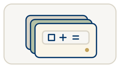
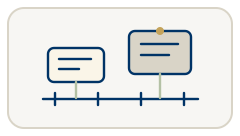

Explore how low-altitude services work, who pays for them, and what it takes to make them viable. This companion to a 12-week course has weekly notes, readings, practice questions, and a class-outline PDF for each week.

::: {.start-here}
**New to the topic? Start here.**

1. [What is LAE?](primer.qmd) — get the basic idea through one service example.
2. [Course overview](overview.qmd) — see how the 12 weeks fit together.
3. [Week 1](week-01.qmd) — begin the course notes.

[Start learning: What is LAE?](primer.qmd){.start-cta}

Need more background? [Choose an Orient topic](howto.qmd#look-up-more-when-needed) when a question comes up. Prefer video? Try the ten [LAE 101 videos](videos.qmd), about two minutes each.
:::

::: {.hub-grid}
::: {.hub-card}

Orient

{.orient-illust}
Week map, primers, how the business works, FAQ, key numbers, short videos, and how to use this site.

- [What is LAE?](primer.qmd)
- [Course overview](overview.qmd)
- [How does LAE work?](business-overview.qmd)
- [Who decides what?](regulators.qmd)
- [How to use this site](howto.qmd)
- [Common questions](faq.qmd)
- [Key numbers](key-figures.qmd)
- [LAE 101 videos](videos.qmd)
:::

::: {.hub-card}

Teach

{.orient-illust}
Weekly lecture material — notes, readings, and a class-outline PDF. Each week ends with a short Self-check.

- [Week 1: Intro](week-01.qmd)
- [Week 2: Markets](week-02.qmd)
- [Week 3: Costs](week-03.qmd)
- [Week 4: Demand](week-04.qmd)
- [Week 5: Infrastructure](week-05.qmd)
- [Week 6: Partnerships](week-06.qmd)
- [Week 7: Policy](week-07.qmd)
- [Week 8: Airspace](week-08.qmd)
- [Week 9: Sizing](week-09.qmd)
- [Week 10: Sustainability](week-10.qmd)
- [Week 11: Capstone](week-11.qmd)
- [Week 12: Frontiers](week-12.qmd)
:::

::: {.hub-card}

Review

{.orient-illust}
Formulas, tables, figures, readings, and Self-check quizzes collected from the week notes.

- [Formulas](formulas.qmd)
- [Tables](tables.qmd)
- [Figures](figures.qmd)
- [Readings](readings.qmd)
- [Self-check](quizzes.qmd)
:::

::: {.hub-card}

Official facts

{.orient-illust}
Terms, checked status, and who is in the market (firms and sectors).

- [Glossary](glossary.qmd)
- [Official status](tracker.qmd)
- [Companies & sectors](landscape.qmd)
:::

::: {.hub-card}

Updates

{.orient-illust}
Dated government and business news, trial and operating use cases, and the timeline.

- [Government news](news.qmd)
- [Business news](industry.qmd)
- [Use cases](usecases.qmd)
- [Timeline](dates.qmd)
:::
:::
